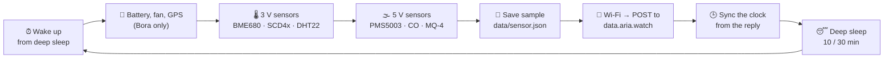

<p align="center">
  <a href="https://aria.watch">
    
  </a>
</p>

<p align="center">
  <strong>MicroPython firmware for the Aria Watch air-quality monitors.</strong><br>
  <em>Know what you breathe. Act for the planet.</em>
</p>

<p align="center">
  <a href="https://aria.watch">Website</a> ·
  <a href="https://app.aria.watch">Web App</a> ·
  <a href="https://aria.watch/docs/borino/pcb-assembly/">Borino assembly guide</a> ·
  <a href="https://github.com/Aria-Watch/Aria-Watch-Borino-PCB">Borino PCB</a>
</p>

---

This firmware runs on the **ESP32-S3** inside every Aria Watch device. It wakes up, measures the air, sends the sample to the Aria Watch server and goes back to deep sleep.

Aria Watch won the **🏆 first prize for the best project at Maker Faire Trieste 2025**. It is no longer actively developed: the devices, the firmware and the online services are kept as a memento of many weekends spent building them.

## The devices

| | **Borino** | **Bora** |
|---|---|---|
| Purpose | Compact board you can [build yourself](https://aria.watch/docs/borino/pcb-assembly/) | Outdoor station in a weather-resistant case |
| Sampling interval | every **10 minutes** | every **30 minutes** |
| Power | USB-C | Battery + solar panel, sensor power rails switched with MOSFETs |
| CO₂, temperature, humidity | SCD4x | SCD4x |
| VOC, pressure, temperature, humidity | BME680 | BME680 |
| Particulate matter (PM1, PM2.5, PM10) | optional (PMS5003) | PMS5003 |
| Carbon monoxide (CO) | optional (UART sensor) | UART sensor |
| Methane (CH₄) | optional (MQ-4) | MQ-4 |
| Extra temperature/humidity | optional (DHT22) | optional (DHT22) |
| GPS position | — | ✅ (refreshed once a day) |
| Air-renewal fan | — | ✅ (4 s before each measurement) |
| Bluetooth configuration | — | ✅ (setup button) |
| Status LED (NeoPixel) | ✅ | ✅ |

The status LED shows the CO₂ level at a glance: **🟢 below 1000 ppm**, **🟠 1000–1499 ppm**, **🔴 1500 ppm and above**. It is blue while the device is measuring.

## How a cycle works



- The sample is sent as **base64-encoded JSON** to [API-Receive](https://github.com/Aria-Watch/API-Receive), which stores it and calculates the air-quality index and scores.
- The last 21 samples stay on the device in `data/sensor.json`, so readings are not lost if Wi-Fi is down for a moment.
- Every 48 samples the device cleans its logs, and the Bora refreshes its GPS position: that is once a day on a Bora, every 8 hours on a Borino.
- On a Bora, holding the **setup button** at wake-up starts the **Bluetooth configuration mode** instead of a measurement.

## Getting started

### 1. Flash MicroPython

Install the MicroPython firmware for the [ESP32-S3](https://micropython.org/download/ESP32_GENERIC_S3/) (for example with `esptool`).

### 2. Fill in `first_boot.json`

```json
{
    "Device_Model": "Borino",
    "User_Email": "you@example.com",
    "WIFI_SSID": "your-wifi",
    "WIFI_PASS": "your-password",
    "PM": false,
    "CO": false,
    "CH4": false,
    "DHT22": false
}
```

| Key | Meaning |
|---|---|
| `Device_Model` | `"Borino"` or `"Bora"` |
| `User_Email` | Email of your Aria Watch account: the device is linked to it automatically |
| `WIFI_SSID` / `WIFI_PASS` | Wi-Fi network |
| `PM`, `CO`, `CH4`, `DHT22` | `true` for each optional sensor that is mounted |

### 3. Copy the files to the board

With [`mpremote`](https://docs.micropython.org/en/latest/reference/mpremote.html):

```bash
mpremote cp -r boot.py main.py config.py first_boot.json Functions lib data :
mpremote reset
```

At the first boot the device:
1. copies the settings into `data/info.json` and `data/wifi.json`;
2. generates its **name** (for example `Borino_a8F3kQ2xZp9L`) and a **device key**;
3. deletes `first_boot.json`.

The device appears in your account after its first sample has been received.

## Bluetooth configuration (Bora)

Hold the setup button while the device wakes up. The button LED turns on and the device advertises as `Bora_123` with a BLE **Nordic UART** service. Connect with any BLE UART app (for example nRF Connect) and send one of these text commands:

| Command | Effect |
|---|---|
| `SetWifi <ssid>` | Sets the Wi-Fi network name |
| `SetWPass <password>` | Sets the Wi-Fi password and reboots |
| `ReadLogs` | Last 5 lines of the "sent" log |
| `ReadError` | Last 5 lines of the error log |
| `ReadWifi` | Last 5 lines of the Wi-Fi log |
| `ReadGPS` | Last 5 lines of the GPS log |

Log replies end with `END`.

## Project layout

```
├── boot.py              # Runs at every wake-up: first-boot setup, power pins (Bora)
├── main.py              # The measurement cycle
├── config.py            # Server URL, pins and per-model settings
├── first_boot.json      # One-time settings, deleted after the first boot
├── Functions/
│   ├── ReadData.py      # Reads every sensor and builds the sample
│   ├── Sensors.py       # Drivers glue: SCD4x, BME680, PMS5003, CO, MQ-4, DHT22
│   ├── SendData.py      # Sends the sample and syncs the clock
│   ├── WifiTools.py     # Wi-Fi connect / disconnect
│   ├── Bluetooth.py     # BLE configuration mode
│   ├── GPS.py           # GPS fix (Bora)
│   ├── LedMng.py        # NeoPixel status LED
│   ├── ErrorHandling.py # Logs in data/log/
│   ├── Tools.py         # First boot, power rails, battery, RTC, log cleanup
│   └── Update.py        # OTA update (disabled, see below)
├── lib/                 # Third-party sensor drivers (MIT / original licences)
└── data/                # Device state: settings, last samples, GPS, logs
```

## Configuration (`config.py`)

| Setting | Default | Meaning |
|---|---|---|
| `API_URL` | `https://data.aria.watch/` | Where samples are sent |
| `DEBUG` | `False` | Prints every step on the serial console |
| `OTA_UPDATE` | `False` | Over-the-air updates (see below) |
| `DEVICE_SETTINGS` | — | Sleep time and pins of each model |

## Known quirks

These are left as they were, as part of the project's history:

- **OTA updates are disabled.** The server tells the device which firmware is the latest, but the download endpoint (`/update`) was never implemented on the server side. With `OTA_UPDATE = True` the device would just log an error.
- **`SetWifi` over Bluetooth** saves the network name under the key `WIFI` instead of `WIFI_SSID`, so in practice only the password command takes effect.
- **The MQ-4 (CH₄) reading** uses a rough calibration factor and should be taken as indicative.

## Credits

The sensor drivers in `lib/` come from the open-source community: Adafruit (BME680), Pimoroni (PMS5003), Amperka TroykaMQ (MQ sensors) and the MicroPython project (BLE advertising). Each file keeps its original licence header.

---

<p align="center">
  Made with 💚 in Italy · <a href="https://aria.watch">aria.watch</a>
</p>
